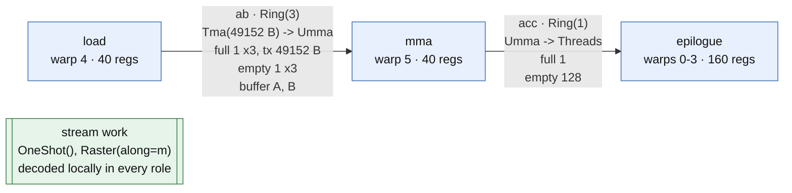
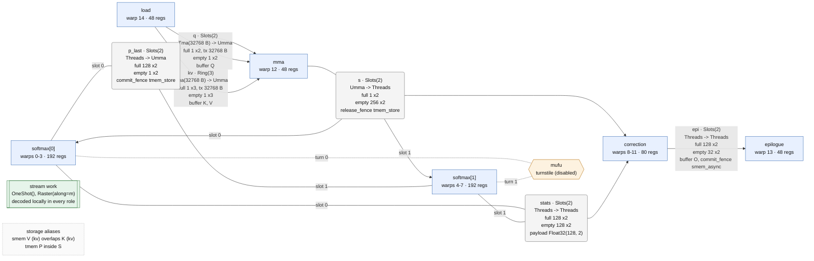
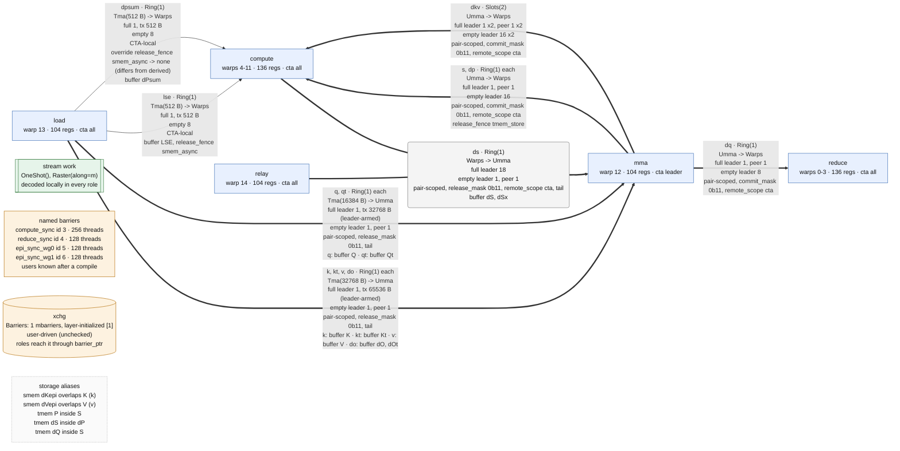

# Tracing

[Back to warpdrive](../README.md)

Use the view that answers your question:

| Question | View | What it records |
|---|---|---|
| Who runs, signals and owns storage? | [`describe()`](#inspect-the-kernel), or [as a graph](#draw-the-pipeline) | Declarations and available compile diagnostics |
| Where does a handle open and close? | [Protocol trace](#trace-the-protocol) | Traced code sites, not runtime iterations |
| When does a role work or wait? | [IKET](#iket) | Instrumented runtime ranges |
| How do those ranges relate to channels? | [Pipeline plan](#join-a-capture-to-the-pipeline-plan) | A per-CTA, work-item model |

None of these proves balanced runtime epochs, race freedom, liveness or a performance bound.

## Inspect the kernel

```python
from transformer_nuggets.cute.warpdrive import ClusterLaunchControl, CtaPair
from transformer_nuggets.cute.warpdrive.examples.persistent_gemm import (
    PersistentGemm,
    compile_persistent_gemm,
)

op = PersistentGemm(schedule=ClusterLaunchControl(), cluster=CtaPair())
print(op.describe())
compile_persistent_gemm(op)
print(op.describe())
```

The first print checks declarations; the second adds available compile results. Here is a
representative post-compile excerpt for the pair GEMM with CLC and default `tile_n=224`.
Print your build for current placement, stages and source lines:

```text
PersistentGemm: 8 warps, 256 threads
  cluster  CTA pair (2, 1, 1), tcgen05 CtaGroup.TWO, leader = rank 0
  params   PersistentGemmParams

Roles
  warps  role            regs  cta     raw
  0-3    epilogue         160  all
  4      load              40  all
  5      mma               40  leader
  6      work.scheduler    40  leader
  7      (padding)         40

Channels
  ab         Ring(6)  load -> mma
             signal    Tma(30720 B) -> Umma
             full      leader 1 x6, tx 61440 B (leader-armed)
             empty     leader 1 x6, peer 1 x6
             scope     pair-scoped, release_mask 0b11, tail
             storage   buffer A, B
             tma       verified CtaGroup.TWO, 30720 B/stage per CTA @ persistent_gemm.py:194,195
  acc        Ring(2)  mma -> epilogue
             signal    Umma -> Threads
             full      leader 1 x2, peer 1 x2
             empty     leader 256 x2
             scope     pair-scoped, commit_mask 0b11, remote_scope cta
  work_ring  Ring(2)  work.scheduler -> epilogue, load, mma, work.scheduler
             signal    Tma(16 B) -> Threads
             full      leader 1 x2, peer 1 x2, tx 16 B (leader-armed)
             empty     leader 384 x2
             scope     pair-scoped, remote_scope cta
             storage   payload Int32(4,)
  work_clc   Slots(1) work.scheduler -> work.scheduler
             signal    Tma(16 B) -> Threads
             full      1, tx 16 B
             empty     32
             scope     CTA-local
             storage   payload Int32(4,), release_fence smem_async

Streams
  work  ClusterLaunchControl(stages=2), Raster(along=m, swizzle=8)
        scheduler warp 6 broadcasts over work_ring
        roles: epilogue, load, mma

TMEM: 448 columns used, 512 allocated
  tmem acc [0, 224), [224, 448)

SMEM plan: 200704 B per CTA in 3 buffer(s), plus alignment padding
  A  BFloat16  98304 B  6 stages (mode -1)  align 1024  -> ab
  B  BFloat16  86016 B  6 stages (mode -1)  align 1024  -> ab
  C  BFloat16  16384 B                      align 128
```

Read one channel at a time:

- **`ab`:** each CTA receives 30 KiB of A/B per stage. The leader arms 60 KiB for the pair;
  `1 x6` means one arrival at each of six FULL barriers. After reading, the MMA releases
  both CTAs (`release_mask 0b11`).
- **`acc`:** UMMA completion publishes to both CTAs. Its leader-owned EMPTY barrier waits
  for `2 * 128 = 256` epilogue threads before reuse.
- **`work_ring`:** the scheduler in the padding warpgroup broadcasts each CLC claim to all
  roles in both CTAs. `work_clc` is its response slot. These names derive from stream `work`:
  `work.scheduler`, `work_ring`, `work_clc`.
- **Storage:** SMEM buffers hold data; barriers track readiness. `SmemPlan` adds sizes,
  stage modes, overlaps and channel bindings after layouts are traced, plus the
  [alias diagnostic](storage.md#check-declared-aliases) for declared overlaps.

`describe()` returns a string. A fresh compile adds recognized TMA copies and traced
checks; a `jit_cache` load restores the saved reports. It is **not a runtime history**.
Two roles can still wait for each other's first publication: declaration counts alone do
not establish progress. Runtime safety needs terminating work, matching epochs, a live
dependency graph and storage for overlapping lifetimes. A timeout needs attribution, not
an assumption that either the layer or the role body is correct.

### Draw the pipeline

`describe(format="mermaid")` draws the same declarations as a
[Mermaid](https://mermaid.js.org/) flowchart, which GitHub renders in Markdown;
`format="dot"` gives Graphviz DOT (`dot -Tsvg`). Like the text, it needs no compile and
adds what a compile recorded: TMA check status, epoch ownership and named-barrier users.

```python
print(op.describe(format="mermaid"))
```

- **Roles** (blue) are role instances with their warps, register budget, CTA placement in a
  cluster, and `raw`.
- **Channels** run from producer to consumer, labelled like the text: stages, signal
  mechanisms, FULL/EMPTY arrival counts, scope, sharing and storage. **Thick** edges cross
  CTAs (pair-scoped); thin ones stay in a CTA. A channel with several roles on a side, or
  slot-bound ends, is a grey junction: producers join it with a line and it points to each
  consumer. Parallel channels that differ only in name and storage share one edge
  (`k, kt, v, do ... each`).
- **Synchronization that is not a handoff** is an orange hub joined by dotted lines: a
  named barrier (`sync`, `arrive`, `native id`; listed in one box before a compile names
  its users), a turnstile (`turn i`) and `Barriers` (to roles taking them as a parameter;
  `barrier_ptr` users are not tracked).
- **Other nodes:** `raw code` on an external channel side, `kernel code` calling a named
  barrier natively, each work stream (pointing to its scheduler when it broadcasts), and one
  note listing SMEM overlaps, shared buffers and TMEM aliases.

The diagrams below are the uncompiled output for the single-CTA GEMM, FA4 forward and the
2-CTA FA4 backward; print your build for current values.

**GEMM** (`examples/gemm.py`): TMA → MMA → epilogue.



**FA4 forward** (`examples/fa4_fwd.py`): each softmax instance owns one slot of `s`,
`p_last` and `stats`; `mufu` (off by default, `turnstile=True`) makes them take turns
around exp2.



**2-CTA FA4 backward** (`FlashAttentionBackward2Cta` in `examples/fa4_bwd.py`): every
MMA-facing channel is pair-scoped, and the leader-only MMA warp issues for both CTAs. In
the dS exchange each CTA's compute warps copy half of dS into the peer's SMEM; the copy
completes on the peer's raw `xchg` barrier, and its `relay` warp forwards that arrival to
the leader on `ds`. Hence `ds` joins compute and relay.



## Trace the protocol

```python
op = PersistentGemm(schedule=ClusterLaunchControl(), cluster=CtaPair())
op.trace_protocol = True  # before the first describe() or compile
compile_persistent_gemm(op)
print(op.describe())
```

This adds acquire/commit/wait/release **sites and source lines**. For example, a wait inside
a runtime loop appears as a traced site, not a log entry for every iteration. Follow a handle
from its open to its close; use IKET, not this log, to locate runtime stalls.

A cache hit does not retrace the body. The examples therefore compile `trace_protocol`
builds uncached via `jit_cache(uncached=...)`. Other saved trace results are restored on a
cache hit; see [compile keys](roles.md#compile-keys).

### TMA checks

The check asks: **do recognized copies complete on the barrier and byte count you declared?**
It follows direct SSA uses of channel barrier pointers and counts static copy boxes in the
handle's opening region. You still supply `Tma(tx_bytes)`.

| Recognized operation | Accounting requirement |
|---|---|
| Tensor TMA load, `tma_bar_ptr=` | Directly in the handle's region, or its `elect_one()` block |
| Bulk `cp.async.bulk` load, `mbar_ptr=` | Directly inside an `elect_one()` block of that region |
| Multicast | Recognized `Cluster.multicast` mask, or `Cluster.fill` for fills |

Bulk atoms `CopyBulkG2SOp` and `CopyBulkG2SMulticastOp` are recognized by type; multicast
masks get the tensor-multicast check. Bulk loads complete on the issuing CTA's barrier,
like group ONE, and **do not elect a lane themselves**. A direct, unelected bulk copy is
issued by every active lane and leaves byte accounting `unverified`.

Read the result literally:

- **`ProtocolError`:** positively wrong CTA group, undeclared multicast, or a complete
  byte-count mismatch. A bulk copy cannot satisfy a channel requiring group TWO. Wrong-group
  and undeclared-multicast evidence rejects even if the byte total is incomplete.
- **`verified`:** recognized group, bytes per stage per CTA, and source sites match.
  Bulk reports say `cp.async.bulk`. Multicast counts the SMEM destination box; in a symmetric
  partition this equals the issuer's delivery across its mask's CTAs.
- **`unverified`:** inspection was incomplete; compilation continues with a warning and
  reasons. Causes include unknown atoms, opaque pointers, nested/dynamic/conditional copies
  other than `elect_one()`, unrecognized masks and unsupported IR. Fills also need enough
  distinct target masks; see [fills](clusters.md#one-cta-loads-for-others).

`verified` does **not** prove descriptor legality, disjoint writes or all async ordering.
Nor does it certify a bulk copy's per-instruction transfer size: bulk copies move whole
contiguous vectors, so give them flat views. Validate raw, unverified and opted-out uses
independently.

A separate context check inspects **direct fields** for MMA CTA span and unsupported
group-TWO/multicast G2S atoms. It neither walks nested objects nor turns off for a per-use
`unchecked("tma")`.

## IKET

```python
from transformer_nuggets.cute.warpdrive import StaticPersistent

op = PersistentGemm(schedule=StaticPersistent()).enable_iket(waits=False)
fn = compile_persistent_gemm(op)
```

Enable IKET before compiling. Start with `waits=False`: short-wait instrumentation can
change the timing you want to understand.

- Roles taking `WorkCursor`: one range per work item, ending at `advance()`.
- Other roles: one range over the body. Instance names remain distinct, e.g. `softmax[0]`.
- Default `waits=True`: nested ranges such as `ab.acquire`, `ab.wait`, `ab.tail`, `q.peek`,
  `mufu.turn` and `compute_sync.sync` for a `NamedBarrier`.
- Try-token probes have no range. The subsequent wait keeps its range, empty if the probe
  already succeeded.

Conceptual timeline (not a measured capture):

```text
load item 0: [ab.acquire][issue copies] ...
mma  item 0:       [----- ab.wait -----][MMA] ...
                          waiting for FULL
```

A wide `ab.wait` says the consumer waited for data; a wide `ab.acquire` says the producer
waited for storage reuse. Neither alone identifies the bottleneck. Match the CTA, role and
epoch to the other side before attributing the delay; overlapping waits are not additive
kernel time.

Add a region in a role:

```python
with self.trace_region("exp"):
    ...  # exp2 work
```

Disabled tracing emits no IKET operations. `iket` and `iket_waits` are part of the kernel's
cache key; `iket_key()` names them in the examples' kernel names.

The following needs NVIDIA's `run-iket` tooling and a script that launches the compiled kernel
once. `profile_kernel.py` is your script, not a file supplied by warpdrive:

```bash
run-iket -o traces/gemm --clobber profile --postprocess all -- python profile_kernel.py
```

## Join a capture to the pipeline plan

```python
from transformer_nuggets.cute.warpdrive import plan_from_warpdrive
from transformer_nuggets.cute.profiler.pipeline import (
    analyze_pipeline,
    load_iket_capture,
    write_pipeline_perfetto,
)

plan = plan_from_warpdrive(op, cta=0)  # after a fresh compile, for traced reuse counts
timeline = plan.schedule(iterations=8)
measured = load_iket_capture("capture.trace.json", timeline, cta=(0, 0, 0))
analysis = analyze_pipeline(timeline, measured)
write_pipeline_perfetto("gemm.pftrace", timeline, measured, analysis=analysis)
```

Use the JSON capture path produced by your IKET run in place of `capture.trace.json`.
Open the resulting trace in [Perfetto](https://ui.perfetto.dev/).

The two `cta` arguments use different coordinates: `plan_from_warpdrive(cta=0)` selects a
**cluster rank**; `load_iket_capture(cta=(0, 0, 0))` selects a **captured logical CTA**. Match
them. In a pair, a rank-1 plan excludes leader-only roles; every rank excludes absent roles.

The plan joins names and dependencies, not individual inner-loop stages:

```text
producer region -- data --> consumer region
producer region <-- reuse -- consumer region
                   one iteration = one work item
```

Reuse distances use traced per-item counts (restored by `jit_cache`); before compilation,
each channel is assumed used once per item. Inner K-loop occupancy is therefore coarse.
Within-item feedback that would form a cycle is modeled as next-item feedback, not a
per-stage causal model. Use explicit epochs and runtime waits for that finer question.
The plan is not a liveness/race proof or a promised performance threshold.

See the [pipeline profiler README](../../profiler/README.md#declarative-pipeline-analysis)
for critical-path analysis, measured timelines and capture tooling.
